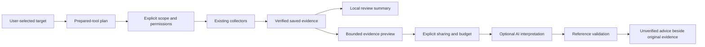
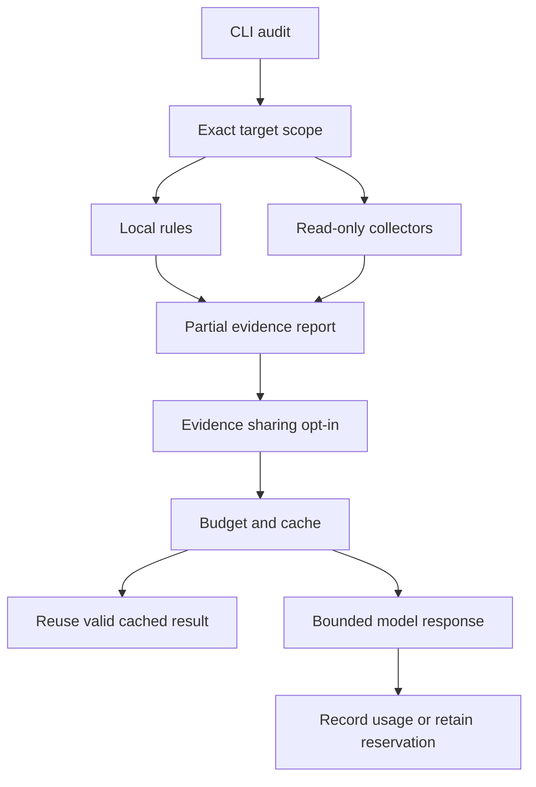

# Architecture

## Console orchestration and evidence interpretation

`tool_plan` selects existing tools deterministically without invoking them.
`workbench_cli` exposes `plan`, `inspect`, `brief`, `ai-prepare` and `setup-check`;
`console` provides guided navigation using the existing validated CLI entrypoints.
`inspect` reuses `ScanService`, not another collector implementation.

`evidence` verifies saved single/batch runs or validates bare report claims and
preserves stable references/provenance. `review_packets` partitions findings without
discarding limitations. `ai_review` requests structured advisory prose and validates
exact reference coverage before caching. `BudgetedAI` records known usage even when
advice is invalid, and retains reservations when outcomes are unknown. None of these
modules executes model output. Existing assessment results remain authoritative.

See [console workflow](CONSOLE_WORKFLOW.md). GUI is a separate client of these
services and is implemented by another contributor.

## Layers

| Layer | Responsibility |
| --- | --- |
| Domain | Scenario, TargetProfile, Control, RiskAssessment, AnalysisResult |
| Application | ThreatAnalyzer orchestrates validation, simulation, and assessment |
| Infrastructure | JSON catalog loading and report file writing |
| Interfaces | CLI first; PySide6 GUI later |

Dependencies flow from interfaces toward the application and domain. The engine must not import Qt or read terminal input. Report writing is explicit; analysis itself does not write files or use the network.

## Package layout

| Planned path | Purpose |
| --- | --- |
| src/ai_threat_lab/models.py | Typed request and result objects |
| src/ai_threat_lab/catalog.py | Scenario loading and validation |
| src/ai_threat_lab/analyzer.py | Shared application service |
| src/ai_threat_lab/risk.py | Scoring and control rules |
| src/ai_threat_lab/reports.py | TXT and JSON serialization |
| src/ai_threat_lab/cli.py | Console adapter |
| src/ai_threat_lab/gui/ | Future desktop adapter |
| src/ai_threat_lab/data/ | Versioned scenario and control JSON |
| tests/ | Domain, service, and export checks |

The core files and packaged data exist. The `gui/` directory remains planned.

## Service contract

`ThreatAnalyzer.list_scenarios() -> tuple[Scenario, ...]`

`ThreatAnalyzer.list_controls() -> tuple[Control, ...]`

`ThreatAnalyzer.analyze(request: AnalysisRequest) -> AnalysisResult`

`export_report(result: AnalysisResult, path: Path, format: str = "txt") -> Path`

`format` accepts `txt` or `json`; the destination must not exist.

AnalysisRequest contains scenario_id, target profile, existing_control_ids, and proposed_control_ids. Existing controls affect the baseline once; proposed controls affect the residual assessment only. Sets must be deduplicated.

AnalysisResult contains scenario identity, fictional target, campaign stages, consequences, baseline assessment, residual assessment, control explanations, assumptions, and model version.

Each assessment contains likelihood, impact, score, level, and explanation items. Unknown scenario/control IDs and invalid ratings produce explicit validation exceptions. User interfaces translate them into readable messages.

This contract is implemented in version 0.1.0. Results also include recommended_controls for unselected applicable defenses. Domain request/result objects are frozen dataclasses and expose tuples to both interfaces. See GUI_HANDOFF.md for a working example.

## Offline code-review service

`code_review.py` exposes `review_source(text, filename)` and `review_file(path)` returning immutable `CodeReviewResult` objects. It is independent of `ThreatAnalyzer` and ordinal risk scoring. The CLI `review-code` adapter renders TXT/JSON and explicitly saves new reports. Future GUI widgets can call the same functions. No provider integration exists.

## Target assessment and campaign orchestration (0.2.0)

`AssessmentService` routes supported input forms, invokes an explicitly registered `TargetAdapter`, or uses the local Python/mail module. It returns `AssessmentResult` with evidence and `not_checked`; unsupported integrations return `not_configured`.

`CampaignService` prepares a `CampaignPlan` through `TrainingContentProvider`. Explicit `ContentApproval` must match the digest of scope, exact content, media hash, facts and recipients before `TrainingTransport` dispatch. `MemoryLedger` is the demo default; `SQLiteLedger` persists hashed attempt claims across service restarts. Event aggregation is independent from ordinal risk scoring and accepts no raw answers.

The CLI exposes campaigns, campaign-demo, campaign-report and assess. Those original commands retain their offline contracts; separate approved SMTP, media and fixed-call adapters now exist. Actual provider implementations, authenticated approvals and collection endpoints are separate integration work. See INTEGRATIONS.md for provider responsibilities and limitations.

## Application/configuration boundary (0.3.0)

`providers.py` provides an explicit ProviderRegistry and guarded content/target/transport adapters. `contracts.py` parses strict, bounded versioned JSON and handles request/plan/approval roundtrips. `workflows.py` orchestrates the offline saved-file lifecycle for CLI and GUI consumers. External exceptions become redacted integration failures; duplicate delivery claims are atomic in both memory and SQLite.

A host application registers trusted adapter instances and can inject its registry into `cli.main`. Config files select names only and accept no credentials/import paths. Release verification combines in-process behavioral tests, real CLI processes, branch coverage, and a clean installed-wheel test outside the repository.

## Explicit network and AI boundaries (0.4.0)

`integration_cli.py` handles opt-in commands. `remote_audit.py` provides read-only adapters over `http_client.py`; `local_inventory.py` extends local observations. `ai_costs.py` explains compact findings through a fixed OpenAI endpoint and a persistent SQLite budget. Neither AI output nor downloaded code becomes an executable command.

See LIVE_SETUP.md for network constraints and API_COSTS.md for accounting/privacy boundaries. The model receives evidence as untrusted data and has no tool or transport access.

## Dependencies and remediation queue (0.5.0)

`dependencies.py` statically inventories exact package versions, optionally queries the fixed OSV batch endpoint and caches only completed per-package results. `audit_report.py` merges validated result documents, preserves evidence provenance and escapes every untrusted HTML field. The report's P1/P2/P3 values are human-review priorities, not empirical severity or vulnerability validation. These workflows do not depend on the AI provider.

## Durable local rehearsal (0.6.0)

`training_lab.py` provides a SQLite-backed local state machine with exact plan approval, recipient/alias uniqueness, atomic idempotent action requests and permanent local plan revocation. It reuses the bounded `VoiceExerciseSession` policy for voice rehearsals. `training_cli.py` exposes numbered input and saved-session commands; it cannot select a provider or store raw replies. Separate rehearsal reports preserve selected-outcome provenance and do not become live campaign evidence.

## Scan bundles and history comparison (0.7.0)

`scan_engine.py` orchestrates injected target/inventory/advisory collectors and preserves failures as explicit gaps. `scan_bundle.py` stages artifacts, claims a new private directory without overwriting, and publishes its hash manifest last. The reader verifies bounded file hashes and regenerates the derived report from assessment documents. `scan_cli.py` provides the one-command workflow and bundle check/comparison commands. Scope/options and module status gate comparisons; an absent observation never proves remediation. Hashes are integrity checks, not signatures or authentic provenance.

## Offline acceptance and literal configuration (0.9.0)

`config_review.inspect_configuration` produces generic candidate observations without interpreting YAML or running containers. `local_inventory.inspect_text` shares it with local and verified GitHub collectors. Scan scope engine 3 prevents cross-version coverage comparisons.

`exercise_export.export_exercise` validates the exact approved plan before preparing inert assets and exclusively claiming a new directory. It never opens media references or calls a transport. `offline_cli.offline_demo` creates only fictional fixtures, drives the existing scan/training services, checks scan acceptance and writes a completion marker last. Its generated synthetic approval cannot authorize a user-supplied plan. `readiness.readiness` returns a static scope inventory without account, credential or API inspection.

## Monorepo inventory (0.10.0)

`dependency_paths` centralizes supported manifest names, portable relative-label validation and bounded breadth-first local discovery. `dependencies.inventory` enforces read/parser limits and passes root or explicitly allowed nested labels to the same in-memory parser. Local paths are never reconstructed from untrusted origin labels. `GithubSnapshot` carries recursive coverage so the scan engine can reject collection/scope disagreement. Scope engine 4 records the new boolean; legacy scopes remain readable without it. See MONOREPOS.md for resource and snapshot limitations.

## Static binary collector (0.11.0)

`binary_audit.audit_binary` reads a bounded regular file and owns descriptor cleanup. `inspect_binary` preserves metadata, then emits selected header/candidate findings only after the relevant PE/ELF structural checks finish. `BinaryFormatError` contains fixed diagnostics without target bytes. The existing local `audit`/`scan` route calls this collector; it does not load or execute binaries. `binary_samples` supplies tiny non-runnable descriptor fixtures to the offline acceptance demo. Scope engine 5 conservatively prevents comparison against earlier collection behavior. See BINARY_AUDIT.md for the exact subset and gaps.

## Python pattern engine (0.12.0)

`code_review` parses bounded source with `ast` and emits nine source-free candidate rule families. Standalone review, local inventory and immutable GitHub collection reuse it. Import aliases and selected literal arguments are recognized; no dependencies are imported, source is executed or data flow is resolved. Scan engine 6 separates its observation scope from earlier bundles. See [CODE_REVIEW.md](CODE_REVIEW.md) for exact loader/hash/TLS semantics.

## Agent evidence adapters

`agent_service` reuses `ScanService`, `read_bundle`, `compare_bundles` and
`DetailedFinding` for compact versioned results. `agent_cli` and `agent_mcp` share
strict schemas in `agent_protocol` and execute fixed workers with a 60-second
operation deadline. `agent_fs` creates bounded private snapshots with opened-handle
checks; original target strings are restored before existing bundle publication.
The MCP root is fixed at startup; no shell, model, network or communication operation
is exposed. Saved reads verify complete bundles before projecting selective views.
See [Agent integration](AGENT_INTEGRATION.md) for the architecture review and
[Agent Mode](AGENT_MODE.md) for the contract, concurrency limits and measurements.
