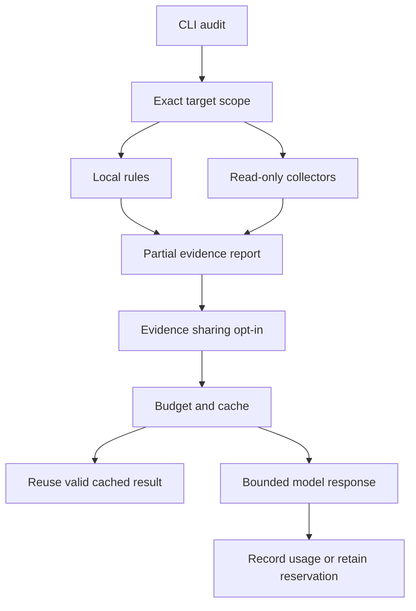

# Architecture

## Layers

| Layer | Responsibility |
| --- | --- |
| Domain | Scenario, TargetProfile, Control, RiskAssessment, AnalysisResult |
| Application | ThreatAnalyzer orchestrates validation, simulation, and assessment |
| Infrastructure | JSON catalog loading and report file writing |
| Interfaces | CLI first; PySide6 GUI later |

Dependencies flow from interfaces toward the application and domain. The engine must not import Qt or read terminal input. Report writing is explicit; analysis itself does not write files or use the network.

## Package layout

| Planned path | Purpose |
| --- | --- |
| src/ai_threat_lab/models.py | Typed request and result objects |
| src/ai_threat_lab/catalog.py | Scenario loading and validation |
| src/ai_threat_lab/analyzer.py | Shared application service |
| src/ai_threat_lab/risk.py | Scoring and control rules |
| src/ai_threat_lab/reports.py | TXT and JSON serialization |
| src/ai_threat_lab/cli.py | Console adapter |
| src/ai_threat_lab/gui/ | Future desktop adapter |
| src/ai_threat_lab/data/ | Versioned scenario and control JSON |
| tests/ | Domain, service, and export checks |

The core files and packaged data exist. The `gui/` directory remains planned.

## Service contract

`ThreatAnalyzer.list_scenarios() -> tuple[Scenario, ...]`

`ThreatAnalyzer.list_controls() -> tuple[Control, ...]`

`ThreatAnalyzer.analyze(request: AnalysisRequest) -> AnalysisResult`

`export_report(result: AnalysisResult, path: Path, format: str = "txt") -> Path`

`format` accepts `txt` or `json`; the destination must not exist.

AnalysisRequest contains scenario_id, target profile, existing_control_ids, and proposed_control_ids. Existing controls affect the baseline once; proposed controls affect the residual assessment only. Sets must be deduplicated.

AnalysisResult contains scenario identity, fictional target, campaign stages, consequences, baseline assessment, residual assessment, control explanations, assumptions, and model version.

Each assessment contains likelihood, impact, score, level, and explanation items. Unknown scenario/control IDs and invalid ratings produce explicit validation exceptions. User interfaces translate them into readable messages.

This contract is implemented in version 0.1.0. Results also include recommended_controls for unselected applicable defenses. Domain request/result objects are frozen dataclasses and expose tuples to both interfaces. See GUI_HANDOFF.md for a working example.

## Offline code-review service

`code_review.py` exposes `review_source(text, filename)` and `review_file(path)` returning immutable `CodeReviewResult` objects. It is independent of `ThreatAnalyzer` and ordinal risk scoring. The CLI `review-code` adapter renders TXT/JSON and explicitly saves new reports. Future GUI widgets can call the same functions. No provider integration exists.

## Target assessment and campaign orchestration (0.2.0)

`AssessmentService` routes supported input forms, invokes an explicitly registered `TargetAdapter`, or uses the local Python/mail module. It returns `AssessmentResult` with evidence and `not_checked`; unsupported integrations return `not_configured`.

`CampaignService` prepares a `CampaignPlan` through `TrainingContentProvider`. Explicit `ContentApproval` must match the digest of scope, exact content, media hash, facts and recipients before `TrainingTransport` dispatch. `MemoryLedger` is the demo default; `SQLiteLedger` persists hashed attempt claims across service restarts. Event aggregation is independent from ordinal risk scoring and accepts no raw answers.

The CLI exposes campaigns, campaign-demo, campaign-report and assess. It has no live-send/call command. Actual provider implementations, authenticated approvals and collection endpoints are separate integration work. See INTEGRATIONS.md for provider responsibilities and limitations.

## Application/configuration boundary (0.3.0)

`providers.py` provides an explicit ProviderRegistry and guarded content/target/transport adapters. `contracts.py` parses strict, bounded versioned JSON and handles request/plan/approval roundtrips. `workflows.py` orchestrates the offline saved-file lifecycle for CLI and GUI consumers. External exceptions become redacted integration failures; duplicate delivery claims are atomic in both memory and SQLite.

A host application registers trusted adapter instances and can inject its registry into `cli.main`. Config files select names only and accept no credentials/import paths. Release verification combines in-process behavioral tests, real CLI processes, branch coverage, and a clean installed-wheel test outside the repository.

## Explicit network and AI boundaries (0.4.0)

`integration_cli.py` handles opt-in commands. `remote_audit.py` provides read-only adapters over `http_client.py`; `local_inventory.py` extends local observations. `ai_costs.py` explains compact findings through a fixed OpenAI endpoint and a persistent SQLite budget. Neither AI output nor downloaded code becomes an executable command.

See LIVE_SETUP.md for network constraints and API_COSTS.md for accounting/privacy boundaries. The model receives evidence as untrusted data and has no tool or transport access.

## Dependencies and remediation queue (0.5.0)

`dependencies.py` statically inventories exact package versions, optionally queries the fixed OSV batch endpoint and caches only completed per-package results. `audit_report.py` merges validated result documents, preserves evidence provenance and escapes every untrusted HTML field. The report's P1/P2/P3 values are human-review priorities, not empirical severity or vulnerability validation. These workflows do not depend on the AI provider.
