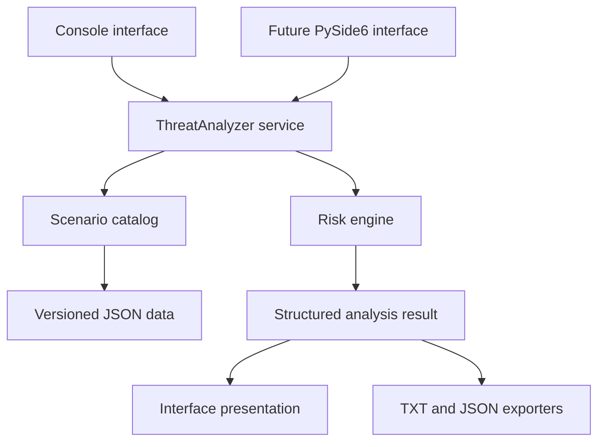
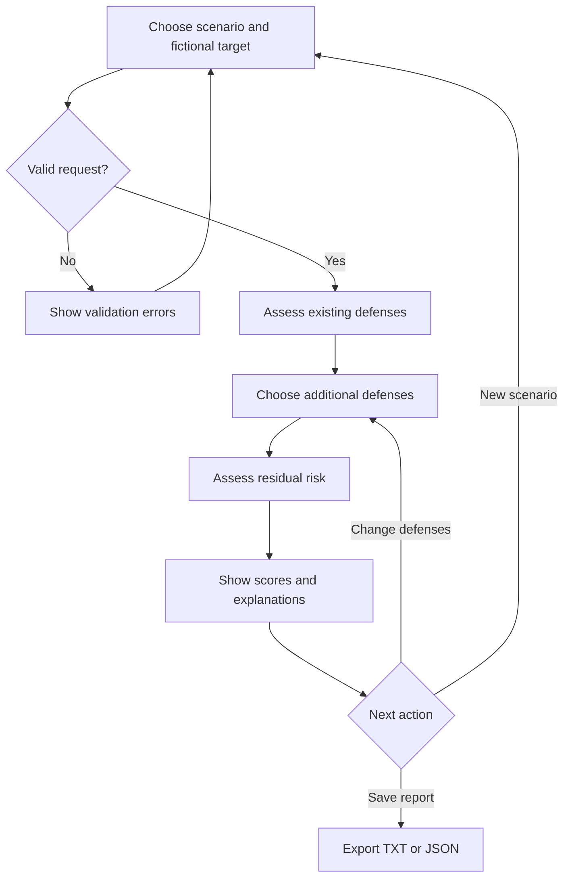
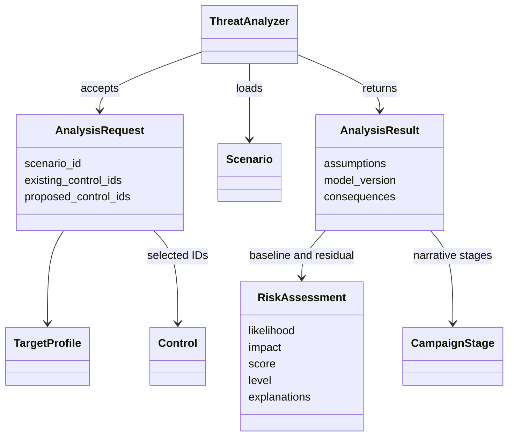

# Design diagrams

These diagrams describe the shared architecture. The engine, CLI, catalog, and TXT/JSON exporters are implemented; GUI is planned.

## Application components

CLI and GUI share the same analysis rules. Exporters serialize results without recalculating risk.

## Analysis lifecycle

## Domain relationships

These names match the implemented API concepts.
