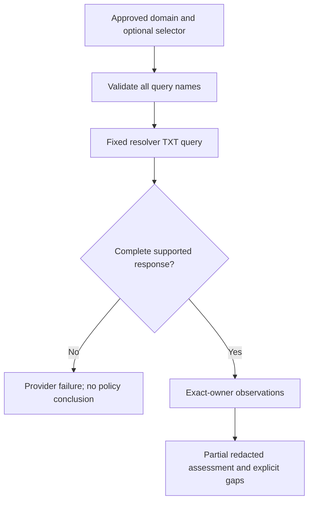

# Mail-domain DNS audit — bounded collector

Version 0.37.0 closes the offline implementation and acceptance scope below. Real-domain acceptance remains deferred. No AI key is required for these deterministic observations.

## Usage

```bash
ai-threat-lab audit mail-domain:example.com --network --allow-host example.com
ai-threat-lab scan mail-domain:example.com --network --allow-host example.com \
  --dkim-selector actual-selector --output-dir mail-domain-review
ai-threat-lab scan-check mail-domain-review
```

Replace the domain and selector with the approved domain and the selector actually used by outgoing messages. Omitting the selector explicitly leaves DKIM unchecked. DNS queries reveal the domain and optional selector to the fixed Cloudflare DNS-over-HTTPS resolver. No mailbox login, message delivery, recipient lookup or AI request occurs.

The CLI requires both network opt-in and the exact target domain in `--allow-host`. The built-in transport permits only `cloudflare-dns.com` for this route. Queries use HTTPS GET `/dns-query`, `name` and `type=TXT`, with `Accept: application/dns-json`. No authorization header is attached. The transport retains its strict complete-body JSON behavior, default 1 MiB response cap and three-request ceiling. Successful assessment makes two queries, or three with an explicit selector; failures stop without retries.

## Interpreting results

| Observation | Meaning and limit |
| --- | --- |
| SPF count | Exact-owner TXT records with `v=spf1` followed by a space or end of record; zero/multiple records produce a review candidate |
| Basic SPF terms | Literal `+all` or absence of explicit `-all`/`~all` produces a candidate; no term ordering, sender-IP evaluation, full grammar or recursive include/redirect interpretation |
| DMARC count | Exact-owner records beginning with `v=DMARC1;` (case-insensitive selection); zero/multiple records produce a candidate |
| Basic DMARC tags | Duplicate/malformed tag syntax or unsupported/missing `p` produce an ambiguity candidate; literal `p=none` produces a monitoring candidate. Other tag values are not fully validated |
| Supplied DKIM selector | TXT presence only; unrelated TXT also counts as presence. No selector discovery, key parsing, cryptographic or signature validation |

A result without findings remains **partial**. Restrictive-looking terms and record presence do not prove effective authentication, valid policies, spoofing resistance or successful delivery. Missing-record candidates describe this resolver's direct answer, not authoritative or DNSSEC-verified absence. Raw TXT values, reporting addresses and DKIM key material are omitted from result evidence.

## Provider and parser boundaries

`Status` must be an integer 0 or 3; booleans/floats are rejected. Truncation, malformed answer containers/metadata, mismatched optional questions, contradictory NXDOMAIN answers and more than 256 answers cause a controlled provider failure. Missing `Answer` means an empty answer section. Optional `TC` defaults to false, and optional `Question`, when present, must contain exactly the requested name and integer TXT type. The collector does not infer DNSSEC verification from transport security.

Answer owner names support ASCII letters, digits, underscores and hyphens in labels of 1–63 characters, up to 253 characters excluding an optional final dot; other presentations fail explicitly. Only exact-owner TXT records contribute to observations. A matching-owner CNAME/DNAME fails as unsupported alias resolution, without following the alias or producing a missing-policy conclusion. Different-owner answers are ignored after metadata validation. Derived query names must fit 253 characters before any query is sent.

TXT decoding intentionally accepts only space/tab-separated double-quoted chunks, printable ASCII contents, escaped nondigits and three-decimal-digit byte escapes that decode to printable ASCII. Each decoded chunk is at most 255 characters, combined content at most 65,535 characters, and presentation text at most 262,144 characters. Shell single quotes, unquoted presentations, controls/non-ASCII, adjacent chunks without separators, malformed escapes and oversized content fail explicitly. This is a bounded supported subset, not a complete DNS master-file parser.



`audit` returns exit 3 on a provider failure. `scan` preserves a verified bundle with failed module metadata, an assessment marked `not_configured`, no target findings and an explicit no-conclusion notice; its exit code is also 3. Earlier valid query results are not published as a completed assessment if a later query fails.

No SPF expansion, organizational DMARC inheritance, DNSSEC validation, cache consistency/freshness proof, message authentication, delivery testing or mailbox access is implemented here. OS DNS resolution and socket timeout behavior do not constitute a whole-job deadline. Gmail account auditing is a separate fixture-tested integration.

## Acceptance and compatibility

`tests/test_mail_domain_boundary.py` covers supported and malformed documents, record ownership, questions, alias handling, TXT decoding/bounds, policy ambiguity, no-query preflight and legacy bundle compatibility. Existing remote-audit tests remain required.

`scripts/check_mail_domain_offline.py` runs through CLI services with sockets and DNS resolution blocked. The installed-wheel gate invokes it outside the checkout: five successful synthetic queries, three scope rejections, six provider-failure controls, verified saved bundles, zero live requests and zero AI calls. These fixtures establish local behavior, not real-resolver acceptance.

Engine `read-only-pipeline-24` records the changed interpretation. Engine 23 bundles remain readable, but observation comparison across engines is rejected. Full release gates include Ruff, pytest/coverage, wheel/sdist build, clean installation and Linux/Windows CI on Python 3.12–3.14.

Primary references: [Cloudflare JSON DoH contract](https://developers.cloudflare.com/1.1.1.1/encryption/dns-over-https/make-api-requests/dns-json/), [RFC 1035 TXT/presentation syntax](https://www.rfc-editor.org/rfc/rfc1035.html), [RFC 7208 SPF record selection](https://www.rfc-editor.org/rfc/rfc7208.html#section-4.5), [RFC 7489 DMARC](https://www.rfc-editor.org/rfc/rfc7489.html). Provider JSON behavior and the supported local subset require controlled live validation before claiming operational readiness.
