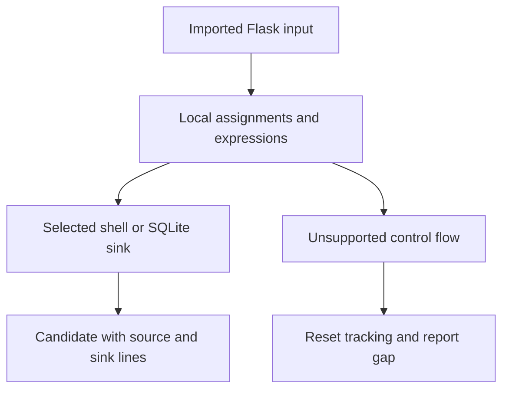

# Selected Python input-flow analysis — 0.20.0

`review-code`, local project scans and pinned GitHub scans now perform a bounded straight-line dependency analysis alongside the existing API-pattern rules. PY013 connects selected Flask input to shell command arguments; PY014 connects it to query text sent to a statically recognized SQLite connection/cursor. Both are candidates requiring human validation.

```bash
ai-threat-lab review-code app.py --format json --output review.json
ai-threat-lab review-code app.py --format sarif --output review.sarif
ai-threat-lab scan path/to/project --output-dir scan-results/flow-01
```

## What is tracked

A Flask request binding must come from a supported explicit absolute import, such as `from flask import request` or `import flask as f`. Merely naming an unimported object `request` does not create a flow source. Selected attributes are `args`, `form`, `values`, `cookies`, `headers`, `json`, `data` and `query_string`; selected calls are `get_json` and `get_data`. Access through subscripts and selected `.get`/`.getlist` calls retains the original source line.

Simple name assignments, chained assignments, annotations and `+=` carry source origins. Concatenation, percent formatting, f-string values, collection literals, `str` and selected string method spellings (`format`, `join`, `strip`, `lstrip`, `rstrip`, `lower`, `upper`, `replace`, `encode`, `decode`) propagate origins. This does not establish actual runtime types or sanitizer correctness. Reassigning a simple name to a constant clears its tracked origin. Import and object aliases are followed sequentially.

| Sink | Required static evidence | Output |
| --- | --- | --- |
| `os.system` / `os.popen` | Resolved import binding and a tracked command argument | PY013 |
| Selected `subprocess` APIs | Tracked command plus literal `shell=True` | PY013 |
| SQLite `execute`, `executemany`, `executescript` | Receiver derived from imported `sqlite3.connect`, optionally `.cursor()`, and tracked query text | PY014 |

Selected subprocess APIs are `run`, `call`, `Popen`, `check_call` and `check_output`. The first positional command or selected `args`/`command` keyword is considered. Computed shell settings are not resolved. SQLite query selection uses the first argument or `sql` keyword; the parser does not check installed API signatures. Data supplied as a separate SQL binding parameter does not become query-text flow. Arbitrary objects with a method named `execute` are not assumed to be database connections.

This inert example yields PY005 plus PY013 at the shell call, and PY014 at SQLite:

```python
from flask import request
import os, sqlite3

def example():
    value = request.args.get("example")
    command = "example-tool " + value
    os.system(command)
    connection = sqlite3.connect(":memory:")
    query = "SELECT example FROM sample WHERE name = " + value
    connection.execute(query)
```

The auditing tool parses the example; it never imports Flask, opens SQLite, invokes a command or submits input. A function need not be registered as a Flask endpoint to produce a candidate: endpoint reachability is unchecked. A separate API-pattern finding and a flow finding describe distinct static observations, not two confirmed vulnerabilities.

## Evidence and conservative stopping points

Findings include the sink location and up to eight sorted source line numbers. Variable names, query strings, request keys, commands and source snippets are omitted. JSON/text/SARIF retain this information; combined assessment evidence also includes the source lines. Supplied filenames remain visible.

Each module/function body is processed in statement order. Functions receive currently visible imported-symbol bindings, with explicit parameters shadowed, but do not receive caller arguments or captured tracked data/SQLite objects. No function is invoked. Return and raise terminate the analyzed straight-line body. Defaults, decorators, annotations and runtime registration effects are not evaluated.

Branches, loops, with/try, match, classes and global/nonlocal effects are skipped as barriers and clear tracking. Their bodies are not flow analyzed. Relative imports invalidate the selected imported names; star imports clear tracking. Unknown call results, unsupported expression forms and destructuring/attribute/subscript writes generate gaps. Unknown results are not propagated; this must not be interpreted as successful sanitization. Heap updates, closure/global mutation, wrappers, cross-file/cross-function paths and control-flow joins are not modeled. String method spellings and module bindings are static approximations; monkey-patching, forward local binding and later module rebinding can invalidate them.

General limitations and per-file flow gaps are preserved in standalone and local/GitHub assessment outputs. A candidate needs review of endpoint reachability, effective runtime objects, constraints/allowlists, query context and actual attacker control before assigning a vulnerability severity. A clean or skipped path is not proof of safety.

## Resource limits

The existing 256 KiB source limit applies before parsing. Each file's flow pass is bounded to 20,000 statement/expression evaluation steps, expression depth 64, 100 module/function scopes, 200 flow observations and eight source origins per merged value. Gaps retain earlier results when a flow bound is reached. These limits apply to this additional pass; the existing API-pattern pass has its own source-bound behavior. Notice types are fixed and deduplicated, without input values.

Scan engine `read-only-pipeline-12` and Python engine `python-ast-1.3` identify the expanded scope. Earlier bundles remain readable; comparisons across engines are disabled. The offline demo and clean installed-wheel gate exercise a separate three-observation fixture. API setup remains deferred.



Primary API references: [Flask request data](https://flask.palletsprojects.com/en/stable/quickstart/#the-request-object), [SQLite parameter binding](https://docs.python.org/3/library/sqlite3.html), [subprocess shell considerations](https://docs.python.org/3/library/subprocess.html#security-considerations). See [all Python rules](CODE_REVIEW.md) and [delivery status](DELIVERY_STATUS.md).
