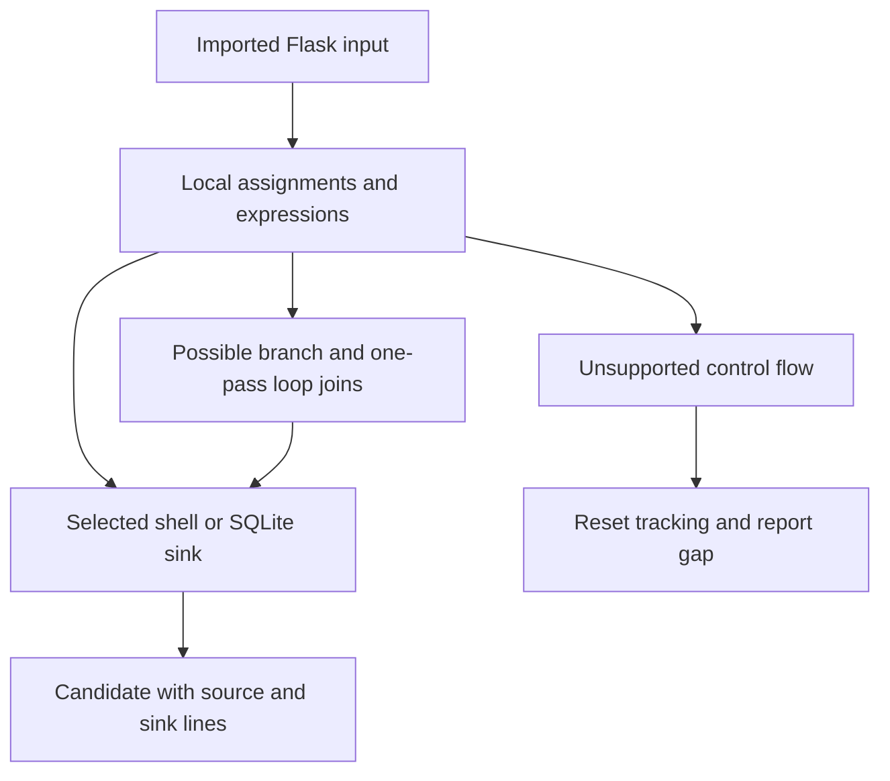

# Selected Python input-flow analysis — 0.26.0

`review-code`, local project scans and pinned GitHub scans now perform a bounded local dependency analysis with possible branch joins, one-pass loops and bounded same-file helper contexts alongside the existing API-pattern rules. PY013 connects selected Flask input to shell command arguments; PY014 connects it to query text sent to a statically recognized SQLite connection/cursor. Both are candidates requiring human validation.

```bash
ai-threat-lab review-code app.py --format json --output review.json
ai-threat-lab review-code app.py --format sarif --output review.sarif
ai-threat-lab scan path/to/project --output-dir scan-results/flow-01
```

Local/GitHub directory scans additionally run a selected root/src regular-package and literal importlib supplement. The limits and cross-file evidence differ from this per-file pass; see [PYTHON_PROJECT_FLOW.md](PYTHON_PROJECT_FLOW.md). Single-file `review-code` does not resolve external files.

## Selected SQLite connection contexts (0.26.0)

The flow pass now traverses selected synchronous `with` bodies when every manager has a known default-factory SQLite connection descriptor. This includes an explicitly imported/aliased `sqlite3.connect`, previously assigned connections and selected helper arguments/returns. `as` targets must be a simple name; omitted targets retain existing bindings. Multiple items are resolved left to right, with a limit of eight items. Nested contexts share the existing block-depth/step limits. Normal body assignments and aliases remain visible after exit; return/raise stops the successor path.

Connection selection requires exactly one database argument, positional or `database=`, and permits the keyword options `timeout`, `detect_types`, `isolation_level`, `check_same_thread`, `cached_statements`, `uri` and `autocommit`. It rejects additional positional arguments, duplicate/unknown keywords, unpacking and every explicit `factory=` override (including the default factory spelling). Argument types, installed API identity and connection success are unverified. Existing non-context SQLite sink recognition remains heuristic.

Cursors and execute results are distinguished from connections for context selection. An ambiguous connection/cursor or connection/unknown branch join cannot enter the selected context; two known connection alternatives can. Unknown/mixed managers, non-name targets and more than eight items skip the body and reset bindings with a coverage gap. Manager expressions in an otherwise size-eligible statement are analyzed in order until an unsupported item; later manager expressions are then skipped. Async contexts, `contextlib.closing`, custom factories/subclasses and arbitrary context-manager protocols remain unsupported.

Only normal-body static dependencies are approximated. The analyzer does not implement transaction state, commit/rollback effects, close/invalidation, `__enter__`/`__exit__` execution, exit exceptions, exception suppression or runtime feasibility. A candidate does not prove the database opens or the query executes. No target code is executed and no target database is opened. A parameterized query's value arguments remain separate from query text.

This scope applies to standalone text/JSON/SARIF, local/GitHub assessments and the supplementary project pass. Python AST engine is `python-ast-1.8`; scan engine is `read-only-pipeline-18`. Older bundles remain readable without comparing observations across engines. See the [SQLite context-manager reference](https://docs.python.org/3.14/library/sqlite3.html#how-to-use-the-connection-context-manager).

## What is tracked

A Flask request binding must come from a supported explicit absolute import, such as `from flask import request` or `import flask as f`. Merely naming an unimported object `request` does not create a flow source. Selected attributes are `args`, `form`, `values`, `cookies`, `headers`, `json`, `data` and `query_string`; selected calls are `get_json` and `get_data`. Access through subscripts and selected `.get`/`.getlist` calls retains the original source line.

Simple name assignments, chained assignments, annotations and `+=` carry source origins. Concatenation, percent formatting, f-string values, collection literals, `str` and selected string method spellings (`format`, `join`, `strip`, `lstrip`, `rstrip`, `lower`, `upper`, `replace`, `encode`, `decode`, `split`, `rsplit`, `splitlines`) propagate origins. This does not establish actual runtime types or sanitizer correctness. Reassigning a simple name to a constant clears its tracked origin. Import and object aliases are followed sequentially.

| Sink | Required static evidence | Output |
| --- | --- | --- |
| `os.system` / `os.popen` | Resolved import binding and a tracked command argument | PY013 |
| Selected `subprocess` APIs | Tracked command plus literal `shell=True` | PY013 |
| SQLite `execute`, `executemany`, `executescript` | Receiver derived from imported `sqlite3.connect`, optionally `.cursor()`, and tracked query text | PY014 |

Selected subprocess APIs are `run`, `call`, `Popen`, `check_call` and `check_output`. The first positional command or selected `args`/`command` keyword is considered. Computed shell settings are not resolved. SQLite query selection uses the first argument or `sql` keyword; the parser does not check installed API signatures. Data supplied as a separate SQL binding parameter does not become query-text flow. Arbitrary objects with a method named `execute` are not assumed to be database connections.

This inert example yields PY005 plus PY013 at the shell call, and PY014 at SQLite:

```python
from flask import request
import os, sqlite3


def example():
    value = request.args.get("example")
    command = "example-tool " + value
    os.system(command)
    connection = sqlite3.connect(":memory:")
    query = "SELECT example FROM sample WHERE name = " + value
    connection.execute(query)
```

The auditing tool parses the example; it never imports Flask, opens SQLite, invokes a command or submits input. A function need not be registered as a Flask endpoint to produce a candidate: endpoint reachability is unchecked. A separate API-pattern finding and a flow finding describe distinct static observations, not two confirmed vulnerabilities.

## Evidence and conservative stopping points

Findings include the sink location, up to eight sorted source line numbers and up to eight sorted local call-site line numbers. Multiple observations of the same sink merge their source/call-site sets; these sets are not an ordered or correlated complete call trace. Variable names, query strings, request keys, commands and source snippets are omitted. JSON/text/SARIF retain this information; combined assessment evidence also includes the source lines. Supplied filenames remain visible.

Each module/function body is processed in statement order. Independent function review receives currently visible imported-symbol/known-helper bindings, with explicit parameters shadowed and no captured tracked data/SQLite objects. Selected calls additionally analyze AST bodies with argument descriptors as described below. No target Python function is executed. Return and raise terminate the analyzed body, and terminated branches do not contribute to successor joins. Defaults, decorators, annotations and runtime registration effects are not evaluated.

Unsupported context managers, try, match, classes and global/nonlocal effects are skipped as barriers and clear tracking. Their bodies are not flow analyzed; selected SQLite with bodies follow the context subset above. Selected branches and loops follow the abstraction below. Relative imports invalidate the selected imported names; star imports clear tracking. Unknown call results, unsupported expression forms and destructuring/attribute/subscript writes generate gaps. Results of unknown calls are not propagated; this must not be interpreted as successful sanitization. Results of supported local helpers follow the limited return model below. Heap updates, closure/global mutation, unknown wrappers, cross-file/cross-method paths, loop convergence and path feasibility are not modeled. String method spellings and module bindings are static approximations; monkey-patching, forward local binding and later module rebinding can invalidate them.

General limitations and per-file flow gaps are preserved in standalone and local/GitHub assessment outputs. A candidate needs review of endpoint reachability, effective runtime objects, constraints/allowlists, query context and actual attacker control before assigning a vulnerability severity. A clean or skipped path is not proof of safety.

## Possible branch and loop paths (0.21.0)

For if/else/elif and conditional expressions, the analyzer visits both possibilities unless the condition itself is exactly literal boolean True or False. It unions source origins from states that can fall through within this abstraction. Return/raise branches contribute their own observations but not successor values. A name assigned only in one branch can carry a possible origin; runtime definite assignment is not proven. API symbols and SQLite receiver identities survive a join only if all reaching states agree; mismatches generate a coverage gap. Different branch origins are intentionally merged, so correlated conditions can produce infeasible candidate paths.

Boolean operands and comparison operands are inspected for nested calls. Direct literal False in an and-expression, or True in an or-expression, stops inspection of subsequent operands. Values from possible boolean operands are merged; comparisons and not do not propagate implicit dependencies from conditions into result values. There is no condition solver, sanitizer proof, arbitrary constant folding or implicit control-flow taint. The API-pattern pass can still report syntax in a branch pruned by the flow pass.

For loops bind a selected target to iterable origins; while loops inspect their condition. Supported string split methods preserve origins. Each body is inspected once, then its fallthrough state is joined with the zero-iteration state. A literal while False skips its body; a literal while True with no supported break cannot reach its successor or else. Other loop else blocks are inspected after the join. Iterables are not executed or checked for actual cardinality: even a literal nonempty iterable is represented with a possible zero-iteration path.

Every inspected loop retains a one-pass/loop-carried-dependency gap. Dependencies established at the end of one iteration and consumed at the beginning of a later iteration may be missed. This is not a fixed-point or convergence analysis. Loops whose AST subtree contains break or continue are skipped entirely and reset tracking with a gap, including their else blocks; this deliberately conservative check can also skip an outer loop because of an exit in a nested loop. Async loops and exception paths remain barriers.

Sequential state joins avoid enumerating combinations of all complete execution paths. The resulting observations describe possible static dependencies, not proven runtime paths or confirmed injection. Branch and loop checks reuse the same source/sink identities and report routes.

## Bounded same-file helpers (0.22.0)

Module-level function definitions establish a known callable descriptor in statement order. Their captured analysis environment contains then-visible import/API bindings and previously defined helpers, plus their own identity for recursion detection. Known function aliases can be assigned, passed as parameters or returned when their descriptor remains definite. Branch joins discard ambiguous callable identities with a gap. Definitions inside another function do not become callable descriptors, though their bodies can still receive independent static review.

Selected synchronous, undecorated, non-generator helpers support positional arguments, named arguments, positional-only and keyword-only parameters and literal constant defaults. Binding refuses missing/extra/duplicate arguments or parameter names, positional-only keyword use, unpacking, variadic parameters and non-literal default expressions. The analyzer does not evaluate defaults, annotations or decorators. It also does not authenticate runtime module objects, validate installed APIs or perform a complete lexical binding analysis.

Each supported context gets an isolated copy of captured bindings plus argument value descriptors. Selected HTTP origins, request/API aliases, SQLite identities and known callable references can cross the call boundary. Supported return values merge across possible returns and normal fallthrough; implicit fallthrough is an unknown/untainted descriptor. Returned data descriptors retain bounded call-site evidence when later used as sink data. Unsupported return expressions remain coverage gaps, and no result is treated as a verified sanitizer. Contexts reuse the existing branch/loop abstraction and shared budgets.

Direct and mutual recursion into an active function stop with a gap; no recursive fixed point is computed. Async/generator/decorated/nested functions and unknown/imported/forward helpers are not resolved as supported calls. A helper defined after the enclosing function's captured environment may remain unresolved even if a later real call would see it. Later global rebinding, monkey-patching, closures, heap mutation, object methods, exceptions and non-returning callee behavior are not propagated back into the caller. These limitations can produce both missed and infeasible candidates. A caller may continue abstract analysis even where a real callee would raise or not return.

For example, this inert source produces an API-pattern and flow observation at `os.system`:

```python
from flask import request
import os


def prepare(value):
    return "example-tool " + value


def run_command(value):
    os.system(value)


def endpoint():
    command = prepare(request.args.get("example"))
    run_command(command)
```

The analyzer reads the helper bodies and propagates descriptors; it never calls the inspected code. The endpoint need not be registered or reachable. Source/call-site lines describe possible static dependencies requiring human validation.

## Resource limits

The existing 256 KiB source limit applies before parsing. Each file's flow pass is bounded to 20,000 statement/expression evaluation steps, expression depth 64, control-flow block depth 32, 100 module/function scopes, 200 flow observations and eight source origins per merged value. The same pass stores at most 100 known functions and analyzes at most 100 local-call contexts, with depth 4 and at most 32 parameters per supported signature; independent module/function body visits also consume the shared 100-scope budget. Returned values and merged sinks retain at most eight call-site lines. Gaps retain earlier results when a flow bound is reached. These limits apply to this additional pass; the existing API-pattern pass has its own source-bound behavior. Notice types are fixed and deduplicated, without input values.

Scan engine `read-only-pipeline-15` and Python engine `python-ast-1.6` identify the expanded scope. Earlier bundles remain readable; comparisons across engines are disabled. The offline demo and clean installed-wheel gate exercise separate three-observation straight-line, branch/loop and local-helper fixtures. API setup remains deferred.



Primary call-binding reference: [Python call expressions](https://docs.python.org/3/reference/expressions.html#calls). Primary control-flow reference: [Python compound statements](https://docs.python.org/3/reference/compound_stmts.html). Primary API references: [Flask request data](https://flask.palletsprojects.com/en/stable/quickstart/#the-request-object), [SQLite parameter binding](https://docs.python.org/3/library/sqlite3.html), [subprocess shell considerations](https://docs.python.org/3/library/subprocess.html#security-considerations). See [all Python rules](CODE_REVIEW.md) and [delivery status](DELIVERY_STATUS.md).
