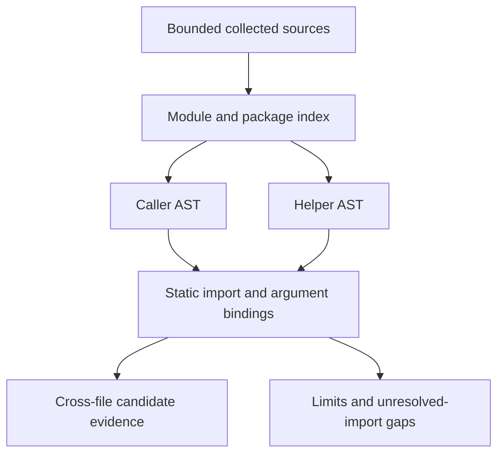

# Selected Python module and package linking — 0.26.0

Directory assessments supplement per-file checks with a bounded static pass over selected Python modules and regular packages. It can connect HTTP data in one file to a selected shell/SQLite sink in another, including supported arguments, return values and SQLite identity. Findings remain candidates for human validation.

```bash
ai-threat-lab audit path/to/project --output assessment.json
ai-threat-lab audit-report assessment.json --format html --output report.html
ai-threat-lab scan path/to/project --output-dir scan-results/project-01
```

The opted-in immutable GitHub collector uses the same pass over its already selected, verified blobs. It does not request additional files to satisfy an import. Single-file `review-code` and Python SARIF remain single-file; this supplement uses existing assessment JSON/HTML and scan/batch reports. No Python target is imported, installed or executed.

## Selected module namespace

The static namespace includes root modules and regular packages with collected `__init__.py` markers at every package level. A conventional `src/` prefix is stripped when no `src/__init__.py` label exists; with that marker, `src` is an ordinary package name. Names must use ASCII Python identifiers, with components at most 255 characters, paths at most 1024 characters and package depth at most eight. Root `__init__.py`, namespace packages, compiled extensions and general dynamic imports remain unresolved; the literal importlib subset is described below.

Selected forms include absolute dotted imports, aliases, definite helper/module re-exports and relative `from .helpers import run`, `from . import helpers` and parent-package imports. Relative imports use the defining module's lexical package even when the helper is called from another file. Imports escaping that package root are rejected. A root/src or module/package name collision produces a gap instead of choosing a runtime search order. Selected exports must be definite function or module descriptors; arbitrary globals, request objects, library re-exports, methods and module `__getattr__` are not inferred. Signatures and contexts follow the [bounded local-call model](PYTHON_FLOW.md).

For example, the two inert files below produce a cross-file PY013 observation at `helpers.py` in addition to the ordinary PY005 API-pattern observation:

```python
# app.py
from flask import request
from helpers import run


def endpoint():
    run(request.args.get("example"))
```

```python
# helpers.py
import os


def run(value):
    os.system(value)
```

These files are parsed only. Imported module bodies and function definitions are traversed as ASTs in statement order and cached in memory. Function environments contain then-visible static bindings, so later definitions/global rebinding may be missed or approximated. Lazy imports inside analyzed functions use the same module index. No runtime import search is performed: a collected file does not establish which module `sys.path`, import hooks or `sys.modules` would actually select.

Known local module names remain local even when their source is oversized, unparsable or excluded by selection budgets; they are not silently reinterpreted as installed libraries. A local name shadowing `flask`, `os` or `sqlite3` therefore requires manual runtime-binding review. Modules outside the collected index can still change real import behavior. Package parents must be available and their abstract initializer passes must complete before exports can be used. A currently traversed parent may resolve its child, but a later noncompleting initializer blocks subsequent cached child exports. No initializer is executed. Cycles produce explicit gaps and partial bindings, without claiming full cycle resolution. If a module's abstract pass does not complete, its exported bindings are discarded rather than assumed usable. Initializer side effects, exceptions, decorators and external environment effects are not validated.

## Literal importlib calls (0.25.0)

The project pass recognizes selected `importlib.import_module` bindings from explicit imports and simple aliases. For example, `helpers = importlib.import_module("pkg.helpers")` can expose a collected helper; `load(".helpers", package="pkg")` and `load("..helpers", "pkg.sub")` use the explicitly supplied literal anchor. The result denotes the requested module, including its dotted suffix. There is no inferred `__package__` or runtime lookup. Absolute names may omit the package argument or supply a literal string/None.

Only direct string constants (including parser-concatenated adjacent literals) are decoded. Names are limited to 1024 characters and ASCII identifier components of at most 255 characters. The existing package/index, source and traversal budgets still apply. Positional and `name`/`package` keyword binding is strict: missing/duplicate/unknown arguments, more than two positional arguments and unpacking are rejected. Variable names, concatenation expressions, f-strings, dynamic package anchors, built-in `__import__`, reload/loaders and uncollected third-party targets remain unchecked. Unsupported calls retain a coverage gap without reflecting argument values into evidence.

Targets must be collected, unambiguous and have completed abstract module/parent passes. A local `importlib.py` or package shadows the library binding instead of silently invoking library semantics. No target import, installation, initializer execution, import hook, filesystem lookup or additional GitHub request occurs. Known module results can pass through selected local helpers and aliases, but construction history is not a complete call trace: a loader/factory site can be absent from a later helper sink's evidence. Existing source/sink and retained call/helper evidence rules still apply.

## Evidence and duplicate scope

Each supplementary observation includes relative sink filename/line/column, source filename/line, retained call-site locations and resolved helper-definition locations. Source values, query strings, commands, argument names and snippets are omitted. Filenames are visible. Internal position offsets never appear in reports.

Origins and call-site evidence merge across bounded contexts. The analyzer does not preserve an ordered, correlated whole-program trace or solve path feasibility. Only observations with cross-module source/call/helper evidence are added; entirely same-file paths remain with the existing per-file results. A cross-file context can overlap an independently observed same-file sink, so observation counts are not counts of confirmed vulnerabilities.

Returns carrying input or selected SQLite identities can link back to a sink in the caller. Selected default-factory SQLite connection descriptors also pass through supported helpers into synchronous with blocks, using the [same context limits](PYTHON_FLOW.md#selected-sqlite-connection-contexts-0260) as the per-file engine. Unknown module exports, unsupported signatures or unknown call results retain gaps; lack of a candidate is not evidence of sanitization or safety. All limitations of branch joins, one-pass loops, recursion stopping and lexical/runtime binding from the per-file engine still apply.

## Bounds and consistency

The input boundary accepts at most 100 collected filename/text pairs and unavailable filename labels in total. Failed local source reads and non-UTF-8 GitHub Python blobs can retain their unavailable local names without retaining source text. The existing collectors limit each Python file to 256 KiB; this supplementary pass also enforces 256 KiB of UTF-8 text per module, at most 20 parse attempts and 2 MiB of attempted source text. Sources are selected in filename order. Package initializers and invalid parse attempts consume both attempt and byte budgets. Unsupported paths are skipped with a gap. Notice types are bounded/deduplicated; at most 20 parse failures can add filename-specific notices.

The shared flow pass retains its statement/expression, block-depth, function-scope, local-call/depth/parameter, source/call-site and finding limits. These budgets apply across the selected modules together, so a large project can exhaust coverage before all possible contexts are visited. No unlisted source is opened or fetched. At most eight helper-definition locations are emitted per observation, prioritizing foreign-module evidence when truncation is necessary; source/call-site sets retain their existing eight-location limits.

Local per-file and project analysis share decoded source text, respecting the declared Python encoding. GitHub keeps its existing UTF-8 and verified-blob policy. Links/non-regular source paths are handled by the collectors, and local Python reads reject non-file inputs before opening. Bundle hashes/checks establish report consistency, not source authenticity or runtime correctness.

The project pass identifies itself as `python-project-modules-1.3`; Python AST engine `python-ast-1.8` and scan engine `read-only-pipeline-18` record the expanded scope. Old bundles remain readable, with cross-engine comparisons disabled. The offline demo and clean installed-wheel gate verify an inert root-module fixture, a src-package/relative-import fixture and a literal importlib fixture, each with three observations. API setup remains deferred.



Primary references: [importlib.import_module](https://docs.python.org/3.14/library/importlib.html#importlib.import_module) and [Python import system](https://docs.python.org/3/reference/import.html). See [Python flow scope](PYTHON_FLOW.md), [delivery status](DELIVERY_STATUS.md), [offline acceptance](OFFLINE_ACCEPTANCE.md) and [scan workflow](SCAN_WORKFLOW.md).
