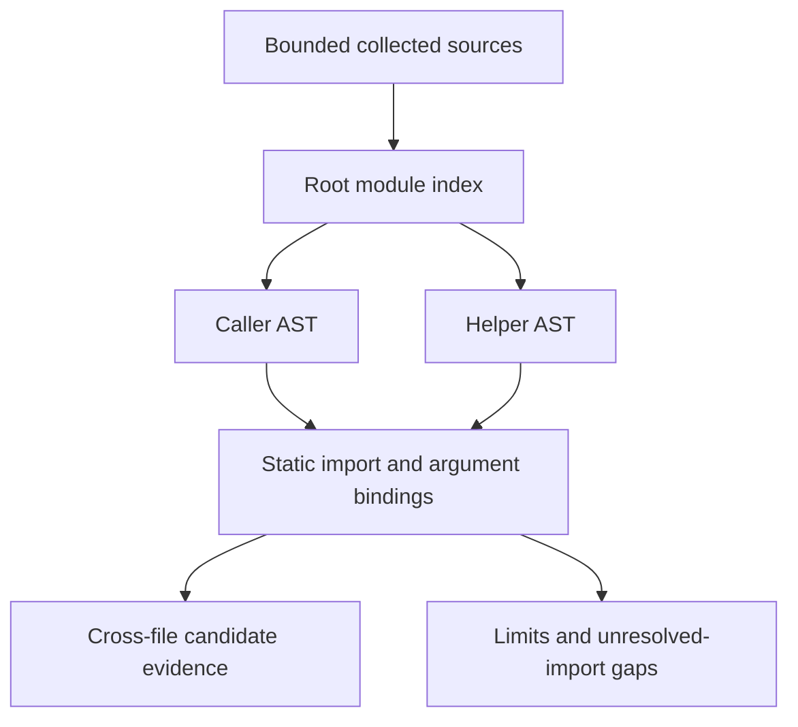

# Selected root Python module linking — 0.23.0

Directory assessments supplement per-file checks with a bounded static pass over selected root Python modules. It can connect HTTP data in one file to a selected shell/SQLite sink in another, including supported arguments, return values and SQLite identity. Findings remain candidates for human validation.

```bash
ai-threat-lab audit path/to/project --output assessment.json
ai-threat-lab audit-report assessment.json --format html --output report.html
ai-threat-lab scan path/to/project --output-dir scan-results/project-01
```

The opted-in immutable GitHub collector uses the same pass over its already selected, verified blobs. It does not request additional files to satisfy an import. Single-file `review-code` and Python SARIF remain single-file; this supplement uses existing assessment JSON/HTML and scan/batch reports. No Python target is imported, installed or executed.

## Selected module namespace

Only flat root basenames matching an ASCII Python identifier plus `.py`, at most 255 characters, are selected; root `__init__.py` is excluded. Packages, nested paths, `src` layouts, relative imports, namespace packages, compiled extensions and dynamic import mechanisms are not resolved. Nested Python files may still receive the existing per-file review, with an explicit project-pass scope gap.

Supported local forms include `from helpers import run`, `from helpers import run as alias`, `import helpers` and `import helpers as h`, where `helpers.py` is a known collected root source. Mixed import statements preserve ordinary non-local API spellings. Selected exports must be definite known function descriptors; arbitrary module globals, request objects, re-exports of library objects, methods and module `__getattr__` are not inferred as callable exports. Function aliases and linked local helper exports can remain definite; signatures and contexts follow the [existing bounded local-call model](PYTHON_FLOW.md).

For example, the two inert files below produce a cross-file PY013 observation at `helpers.py` in addition to the ordinary PY005 API-pattern observation:

```python
# app.py
from flask import request
from helpers import run

def endpoint():
    run(request.args.get("example"))
```

```python
# helpers.py
import os

def run(value):
    os.system(value)
```

These files are parsed only. Imported module bodies and function definitions are traversed as ASTs in statement order and cached in memory. Function environments contain then-visible static bindings, so later definitions/global rebinding may be missed or approximated. Lazy imports inside analyzed functions use the same root index. No runtime import search is performed: a root file does not establish which module `sys.path`, import hooks or `sys.modules` would actually select.

Known local module names remain local even when their source is oversized, unparsable or excluded by selection budgets; they are not silently reinterpreted as installed libraries. A local name shadowing `flask`, `os` or `sqlite3` therefore requires manual runtime-binding review. Modules outside the collected index can still change real import behavior. Cycles produce explicit gaps and partial bindings, without claiming full cycle resolution. If a module's abstract pass does not complete, its exported bindings are discarded rather than assumed usable. Initializer side effects, exceptions, decorators and external environment effects are not validated.

## Evidence and duplicate scope

Each supplementary observation includes relative sink filename/line/column, source filename/line, retained call-site locations and resolved helper-definition locations. Source values, query strings, commands, argument names and snippets are omitted. Filenames are visible. Internal position offsets never appear in reports.

Origins and call-site evidence merge across bounded contexts. The analyzer does not preserve an ordered, correlated whole-program trace or solve path feasibility. Only observations with cross-module source/call/helper evidence are added; entirely same-file paths remain with the existing per-file results. A cross-file context can overlap an independently observed same-file sink, so observation counts are not counts of confirmed vulnerabilities.

Returns carrying input or selected SQLite identities can link back to a sink in the caller. Unknown module exports, unsupported signatures or unknown call results retain gaps; lack of a candidate is not evidence of sanitization or safety. All limitations of branch joins, one-pass loops, recursion stopping and lexical/runtime binding from the per-file engine still apply.

## Bounds and consistency

The input boundary accepts at most 100 collected filename/text pairs and unavailable filename labels in total. Failed local source reads and non-UTF-8 GitHub Python blobs can retain their unavailable local names without retaining source text. The existing collectors limit each Python file to 256 KiB; this supplementary pass also enforces 256 KiB of UTF-8 text per module, at most 20 parse attempts and 2 MiB of attempted source text. Sources are selected in filename order. Invalid parse attempts consume both attempt and byte budgets. Unsupported paths are skipped with a gap. Notice types are bounded/deduplicated; at most 20 parse failures can add filename-specific notices.

The shared flow pass retains its statement/expression, block-depth, function-scope, local-call/depth/parameter, source/call-site and finding limits. These budgets apply across the selected modules together, so a large project can exhaust coverage before all possible contexts are visited. No unlisted source is opened or fetched. At most eight helper-definition locations are emitted per observation, prioritizing foreign-module evidence when truncation is necessary; source/call-site sets retain their existing eight-location limits.

Local per-file and project analysis share decoded source text, respecting the declared Python encoding. GitHub keeps its existing UTF-8 and verified-blob policy. Links/non-regular source paths are handled by the collectors, and local Python reads reject non-file inputs before opening. Bundle hashes/checks establish report consistency, not source authenticity or runtime correctness.

The project pass identifies itself as `python-root-modules-1.0`; scan engine `read-only-pipeline-15` records the expanded scope. Old bundles remain readable, with cross-engine comparisons disabled. The offline demo and clean installed-wheel gate verify an inert two-module three-observation fixture. API setup remains deferred.



Primary reference: [Python import system](https://docs.python.org/3/reference/import.html). See [Python flow scope](PYTHON_FLOW.md), [delivery status](DELIVERY_STATUS.md), [offline acceptance](OFFLINE_ACCEPTANCE.md) and [scan workflow](SCAN_WORKFLOW.md).
