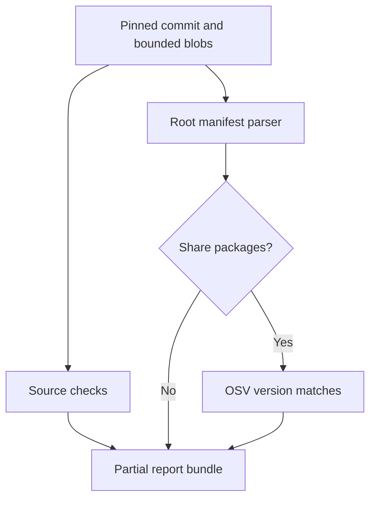

# One-command scans and history comparison — 0.22.0

`scan` orchestrates the existing **selected read-only** collectors. It does not add active attacks, password attempts, live campaigns, model calls or comprehensive vulnerability coverage. All scan results remain partial. API/OAuth prerequisites from [LIVE_SETUP.md](LIVE_SETUP.md) still apply.

## Local scan

```bash
ai-threat-lab scan path/to/project --output-dir scan-results/run-01
ai-threat-lab scan-check scan-results/run-01
```

The output directory must not already exist, including an empty folder or symlink. Parent directories may be created. Keep results outside the scanned project when possible: old JSON reports inside a project can consume collection limits in later runs. Local targets are canonicalized to absolute paths; the source tree is not locked or snapshotted during reading.

For a local project, the workflow runs:

1. Existing limited Python/source/secret/manifest checks.
2. Exact root-directory dependency inventory, without installation or resolution.
3. OSV advisory lookup only if explicitly enabled and exact packages were collected.
4. Combined JSON/HTML reporting and module-status publication.

A Python file, exported mail or program file uses its appropriate collector (including bounded static PE/ELF observations for program paths) without a project-wide dependency inventory. For a single dependency manifest, use `audit-deps` directly. GitHub scans also inventory supported root manifests from the same pinned commit as the source review, within the shared bounds below.

## Enable online dependency lookup

```bash
ai-threat-lab scan path/to/project --output-dir scan-results/online-01 --network --share-packages
# Optional one-hour advisory cache, outside the bundle:
ai-threat-lab scan path/to/project --output-dir scan-results/online-02 --network --share-packages --advisory-cache advisories.sqlite
```

Both flags are required. Without sharing consent, inventory does not become an advisory assessment: module status is `not_requested`, the dependency result is `not_configured`, and the HTML limitations state that no OSV query occurred. An empty inventory never triggers a lookup. No package names/versions are sent to a model.

Options `--max-pages 1..20`, `--max-files 1..100` and `--dkim-selector` retain their existing collector meanings. The file option affects the GitHub collector; local checks retain their own fixed bounds. DKIM selectors apply only to mail-domain targets. Cache paths inside either output or baseline bundles are rejected. Sharing is supported for local-project and GitHub-repository scans.

## Remote targets

```bash
ai-threat-lab scan https://github.com/owner/repository --network --allow-host github.com --output-dir scan-results/github-01
ai-threat-lab scan https://your-domain.example --network --allow-host your-domain.example --output-dir scan-results/web-01
ai-threat-lab scan mail-domain:your-domain.example --network --allow-host your-domain.example --dkim-selector actual-selector --output-dir scan-results/mail-01
ai-threat-lab scan mailbox:owner@example.com --network --allow-host gmail.googleapis.com --output-dir scan-results/mailbox-01
```

Exact host approval is mandatory before collection. Website targets require HTTPS, port 443 and no fragment. No redirects, arbitrary POSTs, crawling or execution occurs. Gmail needs the documented OAuth grants; a model key does not provide mailbox access. These commands use bundled collectors, not arbitrary providers selected by the legacy `--config` registry.

## Optional nested dependency scope

Add `--recursive-dependencies` for a local project directory or GitHub root URL. It discovers supported manifests in bounded subdirectories, preserves relative origins and deduplicates exact identities across subprojects. No network/model call is enabled by this flag. Root-only remains the default. Bounds, exclusions and partial-result behavior are documented in [MONOREPOS.md](MONOREPOS.md).

## GitHub source and dependency snapshot

```bash
# Inventory only; no packages are sent to OSV:
ai-threat-lab scan https://github.com/owner/repository --network --allow-host github.com --output-dir scan-results/github-inventory
# Explicit package/version sharing with OSV:
ai-threat-lab scan https://github.com/owner/repository --network --allow-host github.com --share-packages --output-dir scan-results/github-advisories
```

The default branch is resolved once to an immutable commit. Its tree supplies both source paths and root manifests. Each distinct blob is fetched once, checked against its Git object digest, then reused in memory. Raw repository files are never extracted or saved in the report bundle. The inventory records the commit in its limitations/provenance notices.



Supported root inputs are `requirements*.txt`, npm `package-lock.json` v2/v3, `uv.lock`, `poetry.lock` and crates.io entries in `Cargo.lock` v3/v4. Nested discovery is separately opted into with `--recursive-dependencies`; no includes, installation or workspace dependency resolution occurs. Other lockfile ecosystems remain unchecked. At most 20 manifests and 500 distinct exact package identities are parsed. Root manifests are prioritized by path before other selected text files, so low file limits can leave source files unreviewed.

The **shared** budget is `--max-files` paths (default 50, maximum 100) and 4 MiB decoded bytes. Cached duplicate blobs still consume the path/byte budget. Manifest parsing permits up to 2 MiB per manifest; ordinary source checks remain capped at 256 KiB per file. Larger manifests are parsed for dependencies only. The existing 110-request and 8 MiB response limits remain. Truncation, oversized files and budget stops remain explicit gaps; an empty or incomplete inventory never proves that dependencies are secure.

A malformed retrieved manifest fails the dependency module while preserving source findings. A failed shared GitHub collection marks both source and dependency modules failed and does not refetch a different commit. OSV failure preserves the inventory and source report. Requests are never automatically retried.

## Bundle files

| Artifact | Contents |
| --- | --- |
| `assessment.json` | Target collector evidence, candidate findings and gaps |
| `dependency-inventory.json` | Local/GitHub project exact versions, when inventory succeeds |
| `dependencies.json` | Local/GitHub project OSV result or explicit unchecked/failed placeholder |
| `modules.json` | Partial/collected/empty/failed/not-requested/not-applicable module status |
| `report.json` | Combined remediation queue with provenance and limitations |
| `report.html` | Existing escaped, standalone read-only report |
| `comparison.json` | Optional baseline observation comparison |
| `manifest.json` | Commit marker: schema/run/time/scope, artifact byte lengths and SHA-256 digests |

Collection errors are isolated: useful successful results remain available. An unavailable source collector yields a `not_configured` assessment; failed dependency checks do not erase source observations. Error messages omit provider payloads/secrets. Modules that fail unexpectedly are visibly marked failed. Run the corresponding standalone `audit` or `audit-deps` command when more diagnostic detail is needed.

The summary has `ai_calls: 0`. To request a separate AI explanation, inspect the evidence first and use the documented `ai-explain` workflow with its own budget and transmission opt-in.

## Publication and checking

Complete artifact bytes are staged first. The final directory is claimed with a no-overwrite create; files are written there and the manifest is published **last**. The manifest is the logical commit marker. Readers reject a missing marker, unindexed/missing files, symlinks, invalid JSON, incorrect hashes/sizes or an inconsistent derived report. They do not execute/open the HTML. A write failure attempts to remove only files created by that publication, never unrelated files placed in the directory by another actor.

This is a manifest-last protocol, not an atomic filesystem snapshot or a power-loss durability guarantee. A killed process can leave an incomplete folder; `scan-check` rejects it. Never use a partially written folder as a baseline. Existing folders are not overwritten even if empty or incomplete; choose a new output path after inspecting/removing unwanted artifacts yourself.

Limits: manifest 1 MiB, individual artifact 8 MiB, all indexed artifacts together 32 MiB. Standard collector limits still apply. Oversized scopes fail publication rather than silently omitting findings. On POSIX, the new result directory uses mode `0700`; Windows inherits directory ACLs. Reports can contain private targets, paths, dependency names and evidence. There is no encryption or automatic retention cleanup.

Hashes check **consistency**, not authenticity: someone able to modify all artifacts and the manifest can recompute hashes. There is no digital signature, remote attestation or evidence that the target is secure. The checker additionally regenerates the combined report from the indexed assessment documents.

## Compare another run

```bash
ai-threat-lab scan path/to/project --output-dir scan-results/run-02 --baseline scan-results/run-01
ai-threat-lab scan-compare scan-results/run-01 scan-results/run-02 --output comparison.json
```

Baseline integrity is checked before new collection. It must refer to the same canonical local target or exact remote target string. The new output cannot be inside the baseline folder. Manual `scan-compare` can accept different targets but returns an explicitly non-comparable result.

The comparison uses exact target/finding-field IDs and reports:

- `new_observations`: absent in the prior report;
- `still_observed`: present in both;
- `no_longer_observed`: absent in the new report.

Disappearance is **not proof of a fix**. Changed line numbers/paths, collector limits, skipped files, code changes and advisory cache age can change observations. `coverage_notices_changed` flags changed gap/provenance notices, including a newly pinned GitHub commit. This flag does not validate the completeness of either scan.

Version 0.22 uses scope engine `read-only-pipeline-14` with Go checksum-record inventory, structured Kubernetes JSON and duplicate-preserving selected HTTPS header/CSP/cookie observations, Cargo inventory, bounded EML content observations, fourteen Python AST rule families including selected local Flask-to-shell/SQLite flows with branch joins/one-pass loops and bounded same-file calls, plus static PE/ELF observations and retains strict boolean `recursive_dependencies`. Versions 0.7–0.21 remain readable, but cross-engine comparison is intentionally unavailable. Changing the recursive flag also disables deltas because dependency coverage changes. See [MONOREPOS.md](MONOREPOS.md).

Deltas are suppressed (`comparable: false`, `counts: null`) if target/options scope changes, any compared module fails, or recorded module status/notices change. Options are deliberately compared conservatively, including approved-host lists, configured bounds and whether caching is enabled. No zero-removal or zero-new-finding claim is made when comparison is unavailable.

## Exit codes

| Code | Meaning |
| --- | --- |
| 0 | Requested partial scan/check/comparison completed; not a security all-clear |
| 1 | `scan --fail-on-findings` found candidate observations |
| 2 | Invalid input, existing destination, invalid baseline/bundle, or non-comparable manual comparison |
| 3 | Scan published useful partial results with failed modules |
| 130 | Cancelled by keyboard interruption outside handled publication cleanup |

Module failure takes precedence over finding-based exit 1. Reports are published for module failures so the operator can review successful work. No automatic retry or model invocation occurs.

## Verification

Offline tests cover one-command/installed workflows, real CLI processes, scope and sharing gates, no overwrite, integrity/schema/resource limits, tampering, symlinks, concurrent directory claims, interrupted writes, preservation of unrelated files, failure redaction and comparison labels. Existing provider tests use synthetic HTTP boundaries. No new live target, OSV submission, mailbox account or paid model call was used as this release's test evidence.

## Several local targets (0.15.0)

Use `scan-batch PATH_A PATH_B --output-dir NEW_DIR` for up to ten explicit local targets and a combined report. `batch-check NEW_DIR` verifies the parent index and existing child bundles. Remote inputs are rejected; no network/share option is provided. See [BATCH_SCANS.md](BATCH_SCANS.md). Standalone scan engine 9 and the existing batch format remain supported.
