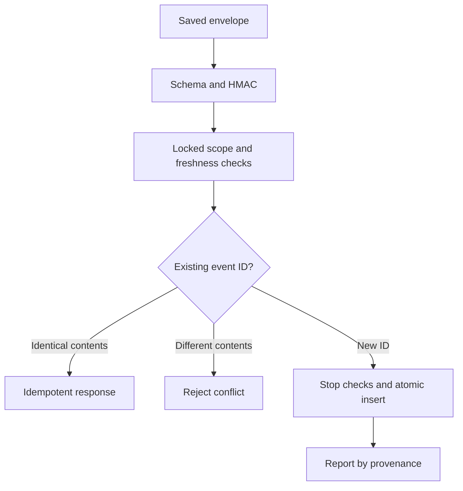

# Local signed training-event journal — 0.29.0

This module prepares a file-based event boundary for future consented training adapters. It validates local HMAC-signed claims, binds them to a caller-approved plan and aliases, and records accepted events transactionally in a separate SQLite journal. It does not run a webhook server, send messages, track links, place calls, generate media or validate a real service/account.

A valid signature establishes possession of a local shared key. It does **not** prove delivery, participant identity or an actual action. `simulation`, `adapter_claim` and automated events stay separate in reports. Approval documents remain caller-supplied, not authenticated reviewer identities. This module does not upgrade the legacy `campaign-report` importer into trusted telemetry.

## Offline console workflow

Prepare and approve a normal campaign plan using the existing commands. Bind participant aliases to zero-based indexes in the approved plan's recipients:

```json
{"schema_version":1,"participants":[{"participant_id":"alias-01","recipient_index":0}]}
```

Save this as `bindings.json`. Every alias and selected index must be unique; select 1–1,000 explicit aliases. Aliases and issuer/event IDs are 1–64 ASCII letters, digits, `_` or `-`, beginning with a letter/digit. Do not use names, addresses, credentials or real replies as aliases.

```bash
ai-threat-lab training-event-keygen --key-file local-signing.key
ai-threat-lab training-events-register plan.json --approval approval.json --bindings bindings.json --issuer local-adapter --key-file local-signing.key --ledger event-claims.sqlite
ai-threat-lab training-events-import event.json --key-file local-signing.key --ledger event-claims.sqlite
ai-threat-lab training-events-report --plan-digest PLAN_SHA256 --ledger event-claims.sqlite
ai-threat-lab training-events-report --plan-digest PLAN_SHA256 --ledger event-claims.sqlite --format html --output claims.html
ai-threat-lab training-events-cancel --plan-digest PLAN_SHA256 --ledger event-claims.sqlite
```

The key is 32 random raw bytes, created exclusively with mode 0600 where supported. It is an internal signing secret, **not an external API key**. Only its SHA-256 fingerprint is returned/stored; plaintext is never printed. Keep the key and journal in a private, trusted directory and out of source control. Existing files are never overwritten. Failed key creation can leave an incomplete exclusive file: remove it manually after diagnosing the error; never treat it as a valid key. Windows ACLs require separate administration.

Registration fixes the exact plan digest, channel, issuer, key fingerprint and alias-to-recipient-index mapping. Repeating identical registration is idempotent while approval is valid. Conflicting registration or permanently cancelled registration cannot silently change or reactivate. Register before accepting events; pre-registration occurrences are rejected. Existing local rehearsal/delivery ledgers are separate and cannot be used as this journal.

## Adapter fixture and envelope

The following creates a **simulation** claim after registration. It does not observe a participant:

```python
import json
from datetime import datetime, timezone
from pathlib import Path
from ai_threat_lab.training_events import read_key, sign_envelope

plan = json.loads(Path("plan.json").read_text(encoding="utf-8"))
now = datetime.now(timezone.utc).isoformat()
body = {
    "schema_version": 1,
    "issuer": "local-adapter",
    "plan_digest": plan["plan_digest"],
    "channel": plan["plan"]["channel"],
    "provenance": "simulation",
    "event_id": "fixture-01",
    "participant_id": "alias-01",
    "type": "verification_requested",
    "automated": False,
    "occurred_at": now,
    "sent_at": now,
}
signed = sign_envelope(body, read_key("local-signing.key"))
with Path("event.json").open("x", encoding="utf-8") as stream:
    json.dump(signed, stream)
```

Every field above plus lowercase 64-hex `signature` is required; extras/raw replies are rejected. Plan digests use lowercase 64-hex SHA-256. `automated` must be a JSON Boolean. Times are valid UTC `YYYY-MM-DDTHH:MM:SS` with optional 1–6 fractional digits, ending in `Z` or `+00:00`, year 1970 or later. Occurrence must not be after signing time.

| Channel | Accepted claim types |
| --- | --- |
| All three | `delivered`, `reported`, `verification_requested`, `declined`, `stop_requested` |
| Email additionally | `opened`, `link_clicked` |
| Voice additionally | `synthetic_info_shared` |
| Video additionally | `opened`, `synthetic_action_acknowledged` |

`provenance` is exactly `simulation` or `adapter_claim`. The publisher supplies the automation/provenance flags; their truth is not independently verified. `verification_requested` records a request/assertion, not successful identity verification. Delivery claims are counted separately from the aggregate number of aliases with claimed actions. Repeated events can overlap and are not employee performance scores.

## Signature contract

Remove only `signature`, then encode the remaining validated object with:

```python
json.dumps(body, sort_keys=True, separators=(",", ":"),
           ensure_ascii=True, allow_nan=False).encode("ascii")
```

The signed bytes are `b"ai-threat-lab:training-event:v1\x00" + canonical_body`. Use HMAC-SHA256 and a lowercase hex digest. Comparison uses `hmac.compare_digest`. All accepted field values are bounded ASCII strings, integer schema version 1 or Booleans; arbitrary floats/nested objects are not part of the protocol. Whitespace/key order in the JSON file does not affect the signature. Timestamp spellings themselves are signed. See the standard-library [HMAC documentation](https://docs.python.org/3/library/hmac.html).

This is a local normalization protocol, **not** any provider's native webhook signature. A future bridge must independently validate its provider's authenticity/account binding, map actual semantics, enforce consent and only then sign a normalized assertion. A key alone does not implement that bridge or prove participant behavior.

## Transactional acceptance and cancellation



Freshness/scope checks occur after acquiring the SQLite writer lock. Signing time may be at most 300 seconds old or 30 seconds ahead of the local clock. Occurrence may be at most 24 hours old, must be at/after registration and no later than signing time. Signing must be before scope expiry; receipt must be while the plan is active. Clock accuracy remains an operational assumption.

Event IDs are unique per registered plan. Identical canonical contents return a duplicate response without another write; changed signed contents under an existing ID are rejected. Freshness, scope expiry and plan cancellation are checked even for retries. Replays after expiry/cancellation are rejected. Separate aliases cannot reuse an event ID within that plan.

A nonautomated `stop_requested` atomically records a marker for that participant **and provenance stream**. New events in that stream are rejected; an identical accepted retry stays idempotent while the plan is active. A simulation stop cannot block a separate adapter-claim stream. Automated stop claims are excluded and do not assert participant intent. Global journal cancellation stops all new acceptance for the plan permanently. Existing records remain reportable.

These commands control only this local journal. `training-cancel` controls the existing rehearsal ledger separately. No remote transport is cancelled or acknowledged by this module; a future dispatcher must honor and reconcile the relevant stop/cancellation state itself.

## Storage, limits and reports

At most 100 plans, 1,000 aliases per registration and 10,000 accepted events **across the journal**. Input envelope files are at most 8 KiB with strict duplicate-key/non-finite/UTF-8 validation. Journals above 32 MiB, links/junctions and nonregular files are rejected. Input handles use regular-file rechecks and no-follow/nonblocking flags where available. The SQLite path must be in a trusted private directory; checks do not make concurrent filesystem replacement an atomic snapshot.

The journal stores plan/channel/issuer/key fingerprint, registration/expiry, alias-to-index bindings, minimal accepted event fields and a canonical payload hash. It stores no raw recipient addresses, preview content, signatures, signing keys or raw participant responses. Reports expose aggregate counts, plan digest, channel and status; individual aliases/recipient indexes and keys are omitted. HTML is escaped and has a restrictive content policy. Outputs refuse overwrites. CLI validation failures return 2; accepted or idempotent imports return 0.

This is a local SQLite journal, not a tamper-proof audit log. File owners can modify it; imported records are not cryptographically revalidated during reporting. Backups/restores or deletion can roll back replay/cancellation history. There is no automatic retention, key rotation, distributed replay cache, HTTP endpoint, trusted webhook bridge, participant authentication or delivery validation. Apply a retention/backup policy and reconcile state before replacing a journal. Do not publish the generated demo directory: it contains a private fixture signing key.

## Acceptance

`offline-demo` uses a fresh private key and all three approved fictional channels. Each requires one simulated action, one excluded automated event, idempotent replay, altered-signature rejection and post-cancellation rejection; no adapter action or verified behavior is claimed. Failure blocks demo completion. The installed-wheel gate repeats key creation, registration, signing/import/retry/report/cancellation using only the installed package. Regression tests cover all envelope fields, key/scope/time boundaries, concurrent duplicates/conflicts, writer-lock rechecks and transaction rollback. A fixed signature vector was independently produced with OpenSSL.
