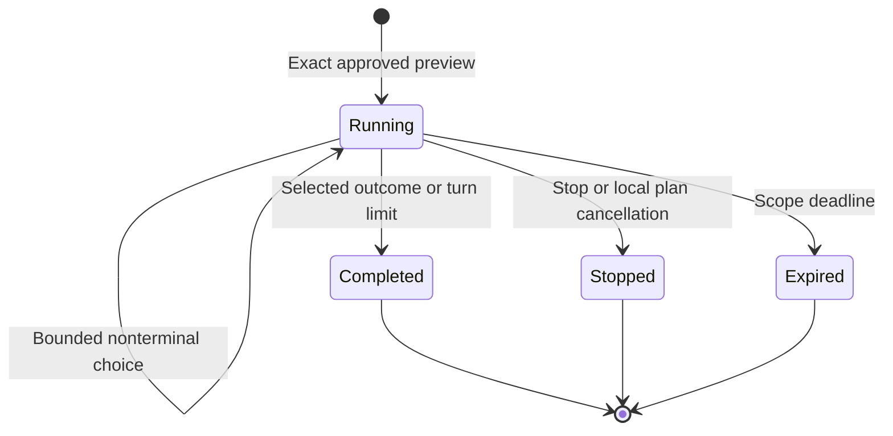

# Approved local training lab — 0.6.0

The lab executes a local text rehearsal of approved email, voice and video training scenarios. It gives the operator/participant a script and numbered choices, then persists selected actions and practice guidance. No AI key, email service, speech API, video generator, telephone provider or network is used.

It **does not measure real staff susceptibility**. No message/call is delivered, no link is visited, no identity is independently checked and no voice/image is generated. Video is a script rehearsal only; media references are never opened. A verification choice is a declaration, not an `identity_verified` event.

## Create and approve a preview

```bash
ai-threat-lab campaign-example voice_training --output request.json
ai-threat-lab campaign-prepare request.json --output plan.json
# Inspect the exact preview and scope before recording approval:
ai-threat-lab campaign-approve plan.json --reviewer "Exercise reviewer" --output approval.json
ai-threat-lab training-start plan.json --approval approval.json --participant-id trainee-01 --ledger training.sqlite --output session.json
```

Use `email_training` or `video_training` for the other channels. Approval must match the exact plan digest and valid time window. Recipients must be unique and inside the plan's allowlist. By default, the first approved recipient is bound to the local session; select another using zero-based `--recipient-index N`. No delivery happens. Scope expiry is inherited, not silently extended.

Approval JSON is a local review record; it is not a cryptographic signature or authenticated user/consent service. Anyone with write access to these files/database can alter them. Operator access control belongs to deployment. Use fictional or separately consented identities and synthetic exercise facts; the library cannot establish real-world consent from a string.

## Use the session

Copy `session_id` from `session.json`:

```bash
ai-threat-lab training-status SESSION_ID --ledger training.sqlite
ai-threat-lab training-run SESSION_ID --ledger training.sqlite
```

Interactive mode accepts only displayed menu numbers. Empty input, EOF and Ctrl+C end the local exercise. Invalid entries are neither echoed by the application nor saved. Do not type real information into the menu. Terminal software can still echo input or keep its own logs; this CLI is not a secret-entry mechanism. Non-printable controls in approved text are escaped before interactive display.

For reproducible scripts or a future GUI, submit structured steps instead:

```bash
ai-threat-lab training-step SESSION_ID --action request_verification --action-id step-01 --ledger training.sqlite
```

An action ID is an opaque ASCII token, 1–64 characters, scoped to that session. Repeating the same ID/action returns `replayed: true`, `applied: false` and current state, without advancing the session. Reusing the ID for a different action is rejected. If omitted, CLI generates a new ID; preserve IDs yourself when implementing retrying clients. Actions after completion/stop/expiry return `applied: false`. A second non-unknown identical selection with a different ID is rejected while running.

Participant IDs have the same opaque-token format and reject email/phone syntax. They are aliases, not verified identities or a guarantee of anonymization. One local session is allowed per plan/alias and per plan/approved-recipient hash, even after it ends. Use a newly reviewed plan for a new round.

## Channel choices and outcomes

| Channel | Additional choices | Boundary |
| --- | --- | --- |
| All | Request verification, report, decline, stop, real-data boundary | All are selected local actions, not verified external events |
| Email | Read preview, select following a synthetic link | Nothing opens or connects; selecting the link ends the rehearsal |
| Voice | Unknown response, select sharing `TRAINING-ALPHA` | Structured signals only; no recording, transcription or free-form dialogue |
| Video | Read text preview, acknowledge a synthetic request | No media is generated, loaded or analyzed |

Report/verification/decline/synthetic-interaction selections finish the rehearsal. Stop and real-data-boundary selections stop it without collecting any information. Voice unknown responses end after at most three such turns, using the existing bounded dialogue policy. Completed outcomes are not rewritten merely because the scope later expires.



## Cancel the entire local plan

Copy `plan_digest` from the session document:

```bash
ai-threat-lab training-cancel --plan-digest PLAN_DIGEST --ledger training.sqlite
```

Cancellation is stored permanently in this database. It stops running sessions for that digest and blocks new sessions under the same plan. Completed/expired sessions retain their outcomes. A new approved plan is required to resume a new round. Repeating cancellation is safe. The command can also revoke a digest before its first local session.

Cancellation and each action use a SQLite transaction. If an interactive prompt is already waiting, the next attempted action observes cancellation; cancellation does not asynchronously interrupt terminal input. This command does not cancel anything at external providers or other databases. There are no live calls to disconnect.

## Reports and follow-up practice

```bash
ai-threat-lab training-report --ledger training.sqlite --output training-results.json
ai-threat-lab training-report --ledger training.sqlite --format html --output training-results.html
ai-threat-lab training-report --ledger training.sqlite --session-id SESSION_ID
```

Reports count **sessions and selected outcomes**, not unique employees or real incidents. They include status, channel, alias and follow-up practice guidance. Stopped/expired/unclassified sessions are not automatic failures. There is no numeric employee ranking, empirical risk score or automatic personnel recommendation. Rehearsal reports remain separate from target-vulnerability reports and imported live-event aggregation.

HTML is escaped, standalone and script-free with a restrictive CSP. Aggregate reports omit approved preview text, addresses and action histories; session/status documents include the approved text and selected action log. Neither includes raw participant responses. Existing output files are never overwritten.

## Persistence and privacy

SQLite stores the approved subject/body, plan digest, scenario/channel, alias, hashed recipient, expiry/status and bounded structured actions. It does not store recipient addresses, voice recordings, transcripts, generated assets or raw menu entries. Approved text can itself contain private facts: review it and protect the database and session exports. A deterministic recipient hash can be guessed for known addresses; it is not anonymization.

New POSIX databases use mode `0600`; Windows inherits directory ACLs. There is no encryption or automatic retention cleanup. Deleting files is an operator decision and is not guaranteed secure erasure. Session tokens are references, not authentication credentials; the database file must remain local/private. Limit: 1000 sessions per database and a 64 KiB serialized preview. Use separate controlled files for separate exercises.

## Verification boundary

Tests cover exact approval and time windows, scope/index/alias validation, privacy, channel restrictions, all terminal outcomes, restart/replay protection, atomic concurrency, expiry, permanent cancellation, control-character escaping, HTML escaping and real CLI subprocesses. Installed-wheel verification runs an approved session, selection, status, HTML report and cancellation outside the checkout. This evidence does not validate any live campaign, media provider or employee response.
