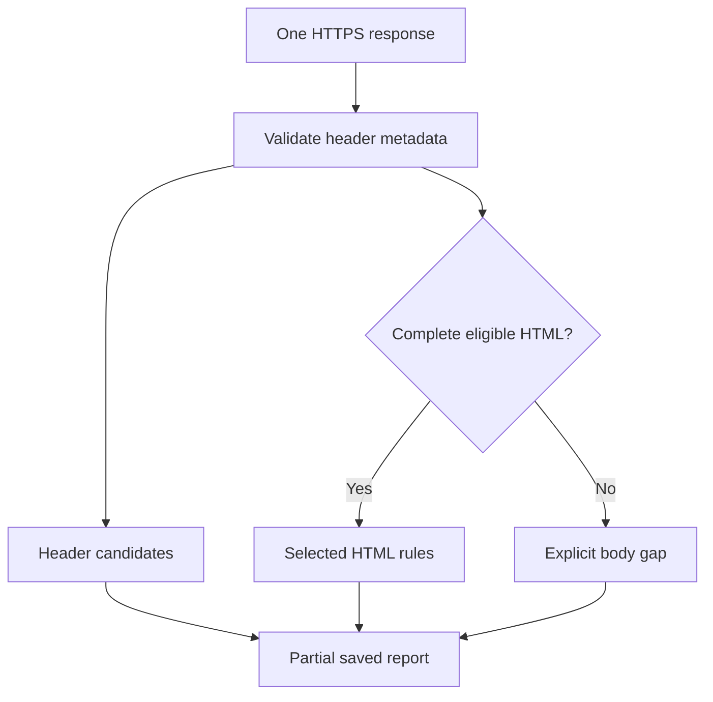

# Passive HTTPS website audit

The collector inspects one supplied HTTPS response for selected header, cookie and static HTML authoring patterns. It does not navigate the application or attempt entry. Use a target and exact host approved for your assessment.

```bash
ai-threat-lab scan https://example.com/login --network --allow-host example.com --output-dir "scan results/site-01"
ai-threat-lab scan-check "scan results/site-01"
ai-threat-lab report-export "scan results/site-01" --format html --output site-report.html
```

`audit` performs the same selected target assessment without a scan bundle. `scan` retains a verified saved run and module statuses. The legacy `assess` command stays a no-network router. Neither website collection nor `scan` calls an AI model.

## Target and connection limits

Use ASCII HTTPS URLs up to 4096 characters, with the default port or explicit 443. Percent-encode non-ASCII paths and queries; use an ASCII/punycode hostname. Credentials, URL fragments, controls and backslashes are rejected. The exact hostname must appear in `--allow-host`, with `--network` supplied explicitly.

The HTTP layer validates public DNS addresses, pins a chosen address while retaining the TLS hostname, and makes one GET with a 15-second socket timeout. Redirect locations, links, scripts, forms and iframe sources are not visited. There is no whole-command deadline, resume or automatic retry. DNS, TLS, request or response-header failure means a failed module, not an empty successful check.

## Header findings survive unavailable content

The collector keeps duplicate response header fields. It applies the shared bounded status/header validator, selected HSTS/CSP/MIME/referrer observations and cookie metadata rules. Those rules do not prove effective browser enforcement or infer whether a cookie is sensitive. Names and values are omitted from cookie evidence.

If the declared response length exceeds 256 KiB, the connection is closed after headers without explicitly reading the body. With unknown length, at most 256 KiB plus one detection byte is read. A body read failure, timeout, oversize response or outstanding declared length discards the entire body; available header observations remain in the partial result and the body gap is recorded. Partial bytes never become HTML findings.

Only a complete status-200 body with one supported text/html declaration and supported UTF-8/identity encoding is eligible for the existing static HTML rules. Compressed, ambiguous, unsupported or malformed bodies remain unchecked. The program does not decompress, render or execute them. Non-200 statuses remain explicit; their bodies/security observations are not treated as a successful page audit.

The analysis decision is:



Generic JSON/provider clients use strict body handling. The header-preservation option is explicitly enabled for website GETs; it does not let model, GitHub, DNS or mailbox JSON parsers accept incomplete data. This separation also prevents valid-looking truncated JSON from being accepted merely because the parser can decode its prefix.

## Reading reports

A partial result with no candidates does not establish that a website is secure. Authentication, authorization, business logic, CSRF behavior, navigation, JavaScript and effective browser policy remain untested. A header candidate may be inapplicable to the response purpose; verify it before deciding on a change.

Reports omit raw cookie/body data and transport exception text, but retain the declared target and selected metadata. Review URLs, especially query strings, before sharing reports. Existing saved HTML/header commands can review exports without network access; their provenance and freshness remain unverified.

Release 0.36 uses scan engine `read-only-pipeline-23` for the changed body-collection contract. Previous supported runs remain readable/exportable, while comparisons across engines deliberately return no delta counts. See [offline acceptance](WEBSITE_OFFLINE_ACCEPTANCE.md), [saved response headers](HTTP_HEADERS.md), [HTML scope](HTML_REVIEW.md) and [scan reports](SCAN_WORKFLOW.md).
